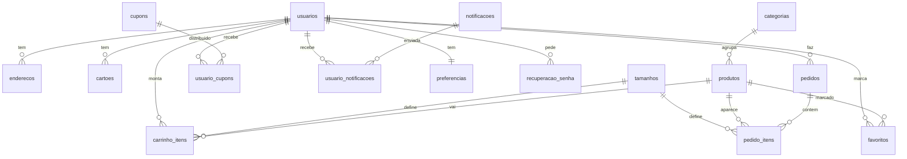
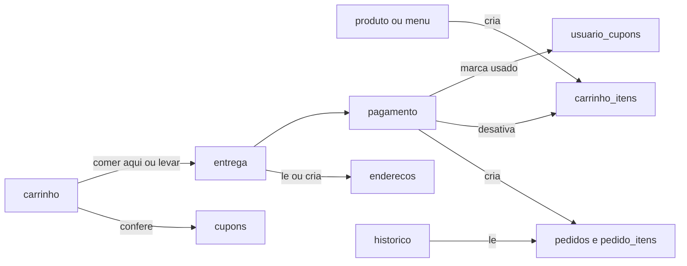

# Banco de dados do Daily Coffee

O app lê e grava os dados do cliente no banco pelo back-end da pasta [back/](../back/): pedidos, endereços, favoritos, cartões, preferências, pontos de fidelidade, notificações e recuperação de senha. Só o carrinho continua na memória (objeto `loja` de [lib/loja.ts](../lib/loja.ts)) até a compra ser finalizada.

As rotas do cliente ficam em [back/database/ClienteBD.js](../back/database/ClienteBD.js) e recebem o id do usuário logado (ex.: `GET /pedidos?usuario=1`). As de senha ficam em [back/database/UsuarioBD.js](../back/database/UsuarioBD.js). Como não há servidor de e-mail, o código de recuperação de senha aparece na própria tela.

O nível do banco segue a referência da turma (`referencia banco e back/projetoLoginEMI`): MySQL simples, com `CREATE TABLE`, `VARCHAR`, `INT`, `DATE` e chaves estrangeiras. A senha fica criptografada com **bcrypt**, como no `UsuarioBD.js` da referência. O back-end fica na pasta [back/](../back/).

O script que cria tudo está em [database/daily_express.sql](../database/daily_express.sql). Ele apaga o banco `daily_express` se ele já existir e cria de novo, já com dados de exemplo. Para atualizar um banco que já existe sem perder os dados, use [database/atualizacao_exclusao_logica.sql](../database/atualizacao_exclusao_logica.sql).

## Exclusão lógica (nada é apagado)

O banco segue o princípio da **exclusão lógica** (em inglês, *soft delete*): nenhuma linha é apagada com `DELETE`. As tabelas que têm um botão de remover no app ganham a coluna `ativo` (`TRUE` por padrão):

- Remover no app = `UPDATE tabela SET ativo = FALSE WHERE id = ?`.
- Listar no app = `SELECT ... WHERE ativo = TRUE`.
- O registro continua no banco: o histórico, os pedidos antigos e os relatórios não perdem nada.

Tabelas com `ativo`: produtos, cupons, enderecos, cartoes, favoritos e carrinho_itens. O back-end faz isso em produtos e cupons ([back/database/LojaBD.js](../back/database/LojaBD.js)) e em endereços, cartões e favoritos ([back/database/ClienteBD.js](../back/database/ClienteBD.js)). Se um cupom removido for cadastrado de novo com o mesmo código, ele é reativado com os dados novos.

## Tabelas, campos e onde cada uma age

### 1. usuarios
- **Campos:** id, nome, email (único), senha (bcrypt), foto, data_nascimento, pontos_fidelidade, ultimo_login, criado_em.
- **Onde age:**
  - [app/cadastro.tsx](../app/cadastro.tsx) cria o usuário (nome, email e senha).
  - [app/login.tsx](../app/login.tsx) confere o email e a senha, e atualiza `ultimo_login`.
  - [app/(tabs)/perfil.tsx](../app/(tabs)/perfil.tsx) mostra o nome, a foto e o "Logado em".
  - [app/fidelidade.tsx](../app/fidelidade.tsx) lê os `pontos_fidelidade`.

### 2. recuperacao_senha
- **Campos:** id, usuario_id, codigo, expira_em, usado.
- **Onde age:**
  - [app/esqueciSenha.tsx](../app/esqueciSenha.tsx) cria o código. O botão "Senha" do perfil também leva para cá.
  - [app/novaSenha.tsx](../app/novaSenha.tsx) marca o código como usado e troca a senha.

### 3. categorias
- **Campos:** id, nome, icone (Promoção, Bebidas, Salgados e Doces).
- **Onde age:** [app/(tabs)/menu.tsx](../app/(tabs)/menu.tsx) lê os botões de categoria.

### 4. produtos
- **Campos:** id, categoria_id, nome, descricao_curta, descricao_completa, preco (copo pequeno), preco_antigo (preço riscado), nota, imagem, ativo.
- **Onde age:**
  - [app/(tabs)/menu.tsx](../app/(tabs)/menu.tsx) faz a lista e a busca.
  - [app/produto.tsx](../app/produto.tsx) mostra o detalhe.

### 5. tamanhos
- **Campos:** sigla (P, M, G), nome, acrescimo (R$0,00, R$2,00 e R$4,00).
- **Onde age:** [app/produto.tsx](../app/produto.tsx) calcula o preço pelo tamanho. O preço final é `preco + acrescimo`, vezes a quantidade.

### 6. favoritos
- **Campos:** id, usuario_id, produto_id, ativo.
- **Onde age:**
  - O coração do menu e do produto cria ou desativa o favorito.
  - [app/(tabs)/favoritos.tsx](../app/(tabs)/favoritos.tsx) lista os favoritos.

### 7. carrinho_itens
- **Campos:** id, usuario_id, produto_id, tamanho, opcional (ex.: "Sem açúcar"), quantidade, ativo.
- **Onde age:**
  - O botão do carrinho no menu e no produto cria o item.
  - "Pedir Novamente" no [app/historicoPedidos.tsx](../app/historicoPedidos.tsx) copia os itens do pedido.
  - [app/(tabs)/carrinho.tsx](../app/(tabs)/carrinho.tsx) altera a quantidade, desativa um item ou todos ("Mover tudo para lixeira").

### 8. enderecos
- **Campos:** id, usuario_id, tipo (CASA ou EMPRESA), rua, numero, bairro, cidade, ativo.
- **Onde age:**
  - [app/endereco.tsx](../app/endereco.tsx) lista, adiciona e desativa.
  - [app/entrega.tsx](../app/entrega.tsx) lista em "Endereços salvos" e cria o endereço novo digitado na compra.

### 9. cartoes
- **Campos:** id, usuario_id, nome (ex.: "Visa final 4821"), ultimos_digitos, validade, ativo.
- **Importante:** nunca guardar o número completo nem o CVV.
- **Onde age:** [app/cartoes.tsx](../app/cartoes.tsx) lista, adiciona e desativa.

### 10. cupons
- **Campos:** id, codigo (único), titulo, descricao, tipo (PORCENTAGEM ou VALOR), valor, validade, ativo.
- **Valores iguais aos do app:** CAFE10 = 10%, FRETEGRÁTIS = R$5,00, ANIVERSÁRIO = R$11,90.
- **Onde age:**
  - [app/cupons.tsx](../app/cupons.tsx) lista os cupons.
  - [app/(tabs)/carrinho.tsx](../app/(tabs)/carrinho.tsx): o botão "Aplicar" confere se o código existe e calcula o desconto.

### 11. usuario_cupons
- **Campos:** id, usuario_id, cupom_id, usado.
- **Onde age:**
  - [app/cupons.tsx](../app/cupons.tsx) mostra quais cupons o usuário tem.
  - [app/pagamento.tsx](../app/pagamento.tsx) marca o cupom como `usado` ao finalizar.

### 12. pedidos
- **Campos:** id, usuario_id, modo (Comer aqui ou Levar), endereco_entrega (texto), forma_pagamento, cupom (texto), subtotal, desconto, total, status (Preparando, A caminho, Entregue), criado_em.
- **Por que o endereço é texto:** o histórico precisa continuar mostrando o endereço mesmo se ele for apagado da tela de Endereços.
- **Onde age:**
  - [app/(tabs)/carrinho.tsx](../app/(tabs)/carrinho.tsx): a pergunta "Vai comer aqui ou levar?" define o `modo`.
  - [app/entrega.tsx](../app/entrega.tsx) define o `endereco_entrega`.
  - [app/pagamento.tsx](../app/pagamento.tsx) cria o pedido ao tocar em Finalizar.
  - [app/historicoPedidos.tsx](../app/historicoPedidos.tsx) lista e busca.

### 13. pedido_itens
- **Campos:** id, pedido_id, produto_id, tamanho, opcional, quantidade, preco_unitario.
- **Detalhe:** o preço fica salvo como era no dia da compra, para não mudar se o produto mudar de preço depois.
- **Onde age:**
  - [app/pagamento.tsx](../app/pagamento.tsx) copia os itens do carrinho.
  - [app/historicoPedidos.tsx](../app/historicoPedidos.tsx) mostra os itens e usa no "Pedir Novamente".

### 14. recompensas
- **Campos:** id, nome, pontos (ex.: Café expresso por 500 pontos).
- **Onde age:** [app/fidelidade.tsx](../app/fidelidade.tsx).

### 15. notificacoes
- **Campos:** id, titulo, descricao, icone, criado_em.
- **Onde age:** [app/(tabs)/notificacoes.tsx](../app/(tabs)/notificacoes.tsx) lista as notificações.

### 16. usuario_notificacoes
- **Campos:** id, usuario_id, notificacao_id, lida.
- **Onde age:** [app/(tabs)/notificacoes.tsx](../app/(tabs)/notificacoes.tsx): o botão "Marcar tudo como lido" muda o campo `lida`.

### 17. preferencias
- **Campos:** usuario_id, tipo_leite, acucar, receber_promocoes, notificacoes_ativas, localizacao_ativa, modo_escuro, idioma (pt, en ou es), volume (0 a 100).
- **Onde age:**
  - [app/personalizacao.tsx](../app/personalizacao.tsx) lê e salva o leite, o açúcar e as promoções.
  - [app/configuracoes.tsx](../app/configuracoes.tsx) lê e salva a localização, as notificações, o idioma e a barra de som.

## De onde vem cada dado hoje (lib/loja.ts) e para onde vai

- `loja.carrinho` vai para **carrinho_itens**.
- `loja.favoritos` vai para **favoritos**.
- `loja.enderecos` vai para **enderecos**.
- `loja.cartoes` vai para **cartoes**.
- `loja.pedidos` vai para **pedidos** e **pedido_itens**.
- `loja.cupom`, `loja.subtotal`, `loja.desconto`, `loja.modo` e `loja.enderecoEntrega` são guardados em **pedidos** quando a compra é finalizada.
- `loja.idioma` e `loja.volume` vão para **preferencias**.
- `ACRESCIMO_TAMANHO` vai para **tamanhos**.
- `CUPONS_VALIDOS` vai para **cupons**.

## Como as tabelas se ligam

## Caminho de uma compra no banco

## O que NÃO vai para o banco

- O texto fixo de [app/sobrenos.tsx](../app/sobrenos.tsx), [app/faleconosco.tsx](../app/faleconosco.tsx) e [app/ajuda.tsx](../app/ajuda.tsx).
- Os estados de tela, que continuam em `useState`:
  - menu aberto e os modais (sair da conta, comer aqui ou levar, formulários);
  - o texto digitado na busca e a categoria selecionada;
  - o tamanho e a quantidade antes de adicionar ao carrinho.

## Usuário de teste

O script já cria um usuário para testar quando o back-end existir:
- **E-mail:** fulano@email.com
- **Senha:** 123456 (no banco ela fica criptografada com bcrypt)
